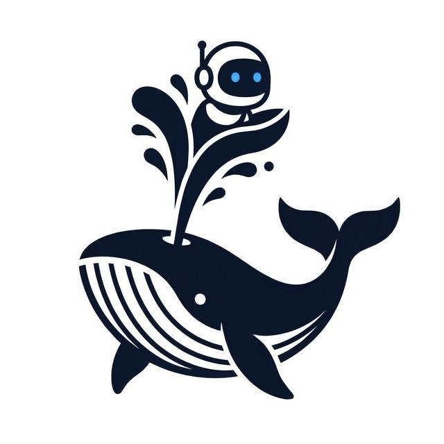

<p align="center">
  
</p>

<h1 align="center">EgoWhale</h1>

<p align="center">
  From egocentric manipulation videos to dual-arm robot demonstrations.
</p>

<p align="center">
  <a href="#quick-start">Quick Start</a> ·
  <a href="#run-one-stage">Run One Stage</a> ·
  <a href="#run-a-corpus">Run a Corpus</a> 
</p>

<p align="center">
  <a href="pyproject.toml"></a>
  <a href="pyproject.toml"></a>
  <a href="egowhale/visual/segment.py"></a>
  <a href="egowhale/visual/render.py"></a>
  <a href="egowhale/batch"></a>
  <a href="LICENSE"></a>
</p>

EgoWhale is a modular pipeline for synthesizing robot demonstrations from egocentric manipulation videos. It combines hand-to-gripper retargeting, person removal, depth-aware robot rendering, and quality curation, with saved intermediate outputs for inspection and reuse. Run one episode locally or process a corpus across GPUs with Ray.

## Examples

Reference synthesis examples from the upstream **Ego2Robot** project:

<p align="center">
  <a href="https://www-ye.github.io/ego2robot_blog/assets/ego2robot_video.mp4">
    
  </a>
</p>


## Quick Start

See the [installation guide](docs/installation.md) for the CUDA environment, model weights, and robot assets. The main pipeline uses Python 3.12+ and MuJoCo EGL rendering on Linux.

```bash
git clone https://github.com/friedrichyuan/EgoWhale.git
cd EgoWhale
python -m pip install -e .
```

After preparing the resources in the installation guide, run an EgoDex episode:

```bash
# Keep episode.hdf5 and episode.mp4 in the same directory.
python -m egowhale path/to/episode.hdf5 outputs/demo
```

The final video is saved to `outputs/demo/visual/composite.mp4`, with the quality report at `outputs/demo/action/quality.json`. Omitting the output directory uses `outputs/<task>/<episode>/`.

> [!TIP]
>
> 1. The full pipeline uses **EgoDex HDF5 + a same-name MP4** with matching frame counts and targets **ARX ACone**. 
> 2. Enable **DynHaMR temporal refinement** on Path B with `dynhamr_enabled: true` in the [hand config](egowhale/wilor/cfgs/wilor_hand_pipeline.yaml). It can improve smoothness and temporal consistency, is **off by default**, and requires additional dependencies and computation.
> 3. **STTN** is the default inpainter. After installing **ProPainter** and its weights, switch with `--inpaint-model propainter`, or set `nodes.inpaint.model: propainter` in a batch config.
> 4. **VLM auditing is optional.** In single-episode runs, set `EGOWHALE_VLM_API_KEY` to let Curate audit eligible episodes using Qwen by default. Without a key, the audit is marked `skipped`; API failures are recorded as `error` and do not by themselves fail the episode. **Ray batch runs disable this audit.


## Run One Stage

Each stage can be launched independently. Run these commands from the repository root; upstream outputs must already exist for stages that need them.

```bash
bash scripts/<stage>.sh path/to/episode.hdf5 [out_dir]
```

| Stage | Script | Main output |
| --- | --- | --- |
| Hand reconstruction | `scripts/wilor.sh` | `action/hands_wilor.npz`, hand overlay |
| Gripper retargeting | `scripts/retarget.sh` | `action/gripper.npz` |
| Person segmentation | `scripts/segment.sh` | `visual/masks.npz` |
| Video inpainting | `scripts/inpaint.sh` | `visual/inpaint.mp4` |
| Depth estimation | `scripts/depth.sh` | `visual/depth.npz` |
| Robot base + IK | `scripts/base_ik.sh` | `action/base.json`, `action/ik.npz` |
| Approach trajectory | `scripts/approach.sh` | `action/prefix.npz` |
| Rendering + compositing | `scripts/composite.sh` | `visual/render.npz`, `visual/composite.mp4` |
| Quality curation | `scripts/curate.sh` | `action/quality.json` |


## Run a Corpus

Use Ray to process many episodes with persistent model actors and configurable GPU/CPU pools:

```bash
bash scripts/batch.sh cfgs/bench8_sttn.yaml \
  --name my_run \
  --episodes path/to/episodes \
  --out outputs
```

`--episodes` accepts HDF5 files, dataset directories, or `.txt` lists of episode paths. Results go to `outputs/my_run/`, with `batch.jsonl` episode records and TensorBoard events in `tb/`. Configure GPU pools, shared action actors, IO queues, and memory limits in YAML.

The supplied preset targets **8 GPUs and a high-memory host**; adapt it to your machine. `--limit 1` limits the episode count while keeping the configured resources. 


## Acknowledgments

EgoWhale builds on [Ego2Robot](https://arxiv.org/abs/2608.02580) for egocentric-to-robot data synthesis. It uses [SAM 3](https://github.com/facebookresearch/sam3), [Cutie](https://github.com/hkchengrex/Cutie), [STTN](https://github.com/researchmm/STTN), [ProPainter](https://github.com/sczhou/ProPainter), [Depth Anything 3](https://github.com/ByteDance-Seed/Depth-Anything-3), [cuRobo](https://curobo.org/), and [MuJoCo](https://mujoco.org/). The hand workflow uses [WiLoR](https://github.com/rolpotamias/WiLoR) through the synchronized Ego2Robot implementation.

## License

EgoWhale is released under the [MIT License](LICENSE). Third-party code, model weights, datasets, and robot assets retain their respective licenses.
