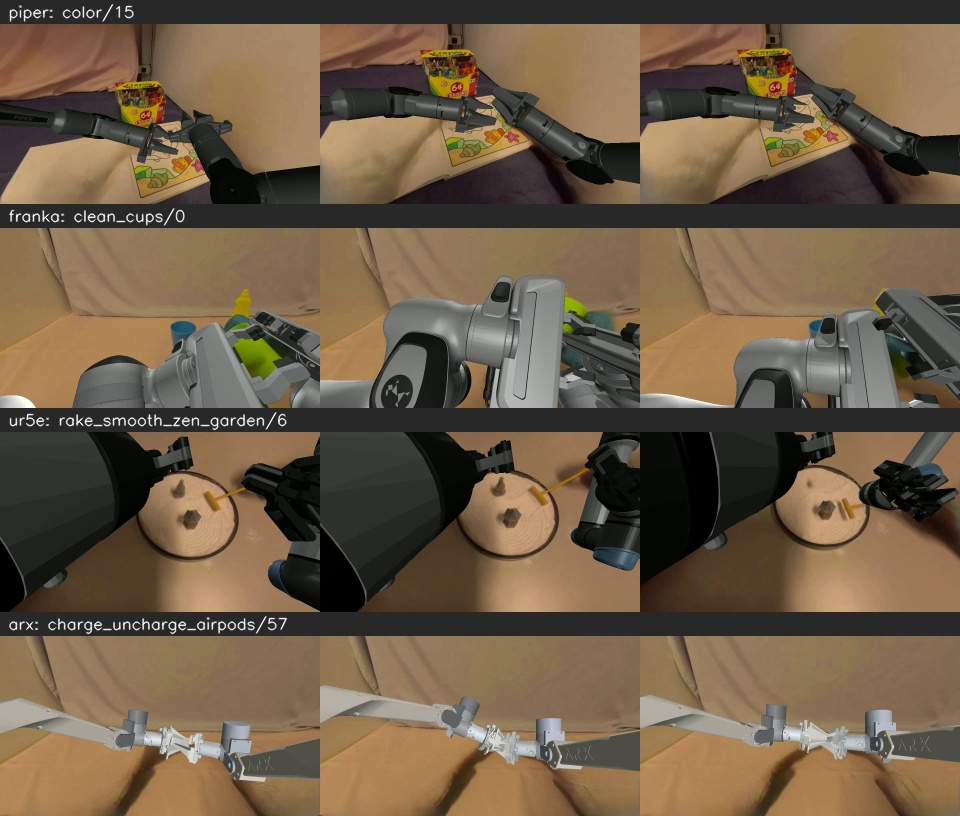

<p align="center">
  
</p>

<h1 align="center">EgoWhale</h1>

<p align="center">
  From egocentric manipulation videos to dual-arm robot demonstrations.
</p>

<p align="center">
  <a href="docs/installation.md">Installation</a> ·
  <a href="#quick-start">Quick Start</a> ·
  <a href="#run-one-stage">Run One Stage</a> ·
  <a href="#run-a-corpus">Run a Corpus</a>
</p>

<p align="center">
  <a href="pyproject.toml"></a>
  <a href="pyproject.toml"></a>
  <a href="egowhale/visual/segment.py"></a>
  <a href="egowhale/visual/render.py"></a>
  <a href="egowhale/batch"></a>
  <a href="LICENSE"></a>
</p>

EgoWhale is a modular pipeline for synthesizing robot demonstrations from egocentric manipulation videos. It combines hand-to-gripper retargeting, person removal, depth-aware robot rendering, and quality curation, with saved intermediate outputs for inspection and reuse. Run one episode locally or process a corpus across GPUs with Ray.

## Examples

EgoWhale synthesizes demonstrations for four robot platforms. From top to bottom, the examples show Piper coloring, Franka cleaning cups, UR5e raking a sand garden, and ARX ACone handling an AirPods charging case.

<p align="center">
  
</p>

## Quick Start

Follow the [installation guide](docs/installation.md) to set up Python, CUDA, model weights, and robot assets on Linux.

```bash
git clone https://github.com/friedrichyuan/EgoWhale.git
cd EgoWhale
```

After setup, run an annotated episode. Keep the HDF5 and MP4 together with the same filename stem and frame count.

```bash
MUJOCO_GL=egl python -m egowhale path/to/episode.hdf5 outputs/demo
```

The final video is saved to `outputs/demo/visual/composite.mp4`, with the quality report at `outputs/demo/action/quality.json`. Omitting the output directory uses `outputs/<task>/<episode>/`.

> [!TIP]
>
> - **ARX ACone** is the default robot. With the corresponding assets installed, select `--robot piper`, `--robot franka`, or `--robot ur5e`.
> - **STTN** is the default inpainter. Select ProPainter with `--inpaint-model propainter` for a single episode or `nodes.inpaint.model: propainter` in the Ray YAML.
> - **VLM auditing** is optional for single-episode runs. Set `EGOWHALE_VLM_API_KEY` to let Curate audit eligible episodes with Qwen. Ray batches skip this audit.

## Run One Stage

Run the stage scripts from the repository root. For an annotated episode, pass its HDF5 and point the stage at an output directory containing any required upstream results.

```bash
bash scripts/retarget.sh path/to/episode.hdf5 outputs/demo
```

| Stage | Script | Main output |
| --- | --- | --- |
| Hand reconstruction (optional) | `scripts/wilor.sh` | `action/hands_wilor.hdf5`, `action/hands_wilor.npz`, hand overlay |
| Gripper retargeting | `scripts/retarget.sh` | `action/gripper.npz` |
| Person segmentation | `scripts/segment.sh` | `visual/masks.npz` |
| Video inpainting | `scripts/inpaint.sh` | `visual/inpaint.mp4` |
| Depth estimation | `scripts/depth.sh` | `visual/depth.npz` |
| Robot base + IK | `scripts/base_ik.sh` | `action/base.json`, `action/ik.npz` |
| Approach trajectory | `scripts/approach.sh` | `action/prefix.npz` |
| Rendering + compositing | `scripts/composite.sh` | `visual/render.npz`, `visual/composite.mp4` |
| Quality curation | `scripts/curate.sh` | `action/quality.json` |

### Hand reconstruction from unlabeled video（optional）

Hand reconstruction is an optional, standalone stage for MP4 videos without hand annotations. It uses DA3 to estimate camera intrinsics and AnyHand/WiLoR to predict 3D hand keypoints. For annotated episodes, start with Retarget.

Run hand reconstruction on a directory of MP4 files across multiple GPUs.

```bash
bash scripts/wilor_multigpu.sh
```

> [!TIP]
>
> Edit [`wilor.yaml`](egowhale/wilor/cfgs/wilor.yaml) to configure hand reconstruction.
>
> - **Temporal refinement** defaults to off. Set `dynhamr_enabled: true` to enable SAM 3 hand masking and DynHaMR/HMP refinement.
> - **Minimum per-hand frame coverage** is controlled by `min_hand_detection_rate` in basic mode. Each hand must meet the threshold independently before and after filtering. The default `0.10` requires detections in at least 10% of the clip's frames. Set `0.20` to require 20%.
> - **Multi-GPU scheduling** uses physical GPU indices. Set `split.input_dir` and `split.output_root`. With refinement off, `split.profiles.basic` assigns `camera_gpus` to DA3 and `wilor_gpus` to WiLoR. With refinement on, `split.profiles.refined` also assigns `mask_gpus` to SAM 3 and `optimizer_gpus` to DynHaMR/HMP. GPU lists must be disjoint within each profile.
> - **Batch output** includes annotated videos in `final_videos/` and HDF5/MP4 pairs in `retarget_inputs/`. Set `SPLIT_CONFIG` when launching the batch script to use a separate experiment YAML.

## Run a Corpus

Use Ray to process many episodes with persistent model actors and configurable GPU/CPU pools.

```bash
bash scripts/batch.sh cfgs/bench8_sttn.yaml \
  --name my_run \
  --episodes path/to/episodes \
  --out outputs
```

`--episodes` accepts HDF5 files, dataset directories, or `.txt` lists of episode paths. Results go to `outputs/my_run/`, with `batch.jsonl` episode records and TensorBoard events in `tb/`. Configure GPU pools, shared action actors, IO queues, and memory limits in [YAML](cfgs/bench8_sttn.yaml).

The supplied preset targets **8 GPUs and a high-memory host**. Adjust its resources for your machine. `--limit 1` runs one episode with the configured resources.

## Acknowledgments

EgoWhale builds on [Ego2Robot](https://arxiv.org/abs/2608.02580) for egocentric-to-robot data synthesis. It uses [SAM 3](https://github.com/facebookresearch/sam3), [Cutie](https://github.com/hkchengrex/Cutie), [STTN](https://github.com/researchmm/STTN), [ProPainter](https://github.com/sczhou/ProPainter), [Depth Anything 3](https://github.com/ByteDance-Seed/Depth-Anything-3), [cuRobo](https://curobo.org/), and [MuJoCo](https://mujoco.org/). The hand workflow uses [WiLoR](https://github.com/rolpotamias/WiLoR) through the synchronized Ego2Robot implementation.

## License

EgoWhale is released under the [MIT License](LICENSE). Third-party code, model weights, datasets, and robot assets retain their respective licenses.
