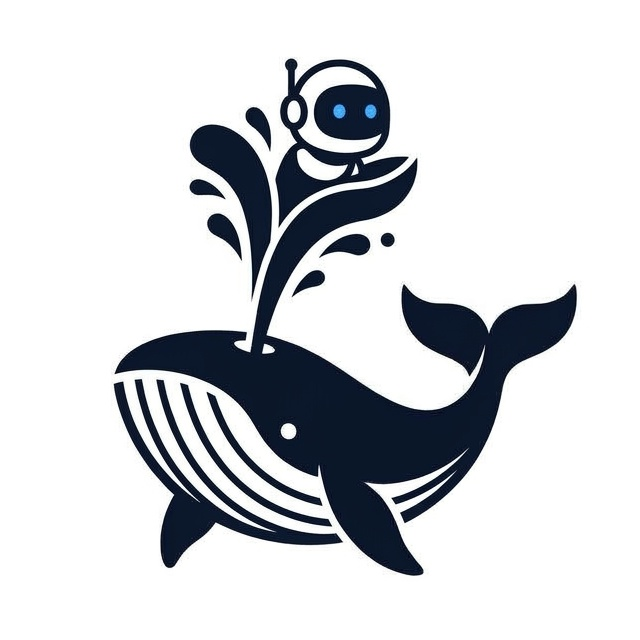

<p align="center">
  
</p>

<h1 align="center">EgoWhale</h1>

<p align="center">
  A framework for large-scale synthesis of robot data from egocentric video.
</p>

<p align="center">
  
  
  
</p>

EgoWhale takes in egocentric manipulation video and writes out dual-arm robot demonstrations: retargeted actions, a person-free scene, a depth-composited robot, and a quality report. Stages are independent and skip work that is already on disk. One episode runs in one process; `egowhale.batch` runs a corpus on Ray, with one heavy model held on each GPU.

## Pipeline

| Stage | What it does | Output |
| --- | --- | --- |
| Retarget | Camera-frame parallel gripper, then smooth | `action/gripper.npz` |
| Segment | Person mask (SAM 3) | `visual/masks.npz` |
| Inpaint | Remove the person (STTN; ProPainter optional) | `visual/inpaint.mp4` |
| Depth | Depth of the original video (Depth Anything 3), scaled to meters | `visual/depth.npz` |
| Base + IK | Base pose and arm trajectory (cuRobo) | `action/base.json`, `action/ik.npz` |
| Approach | TrajOpt from the zero configuration to the first end-effector pose | `action/prefix.npz` |
| Render | MuJoCo render of the arm from the action outputs | `visual/render.npz` |
| Composite | Paste the render; gripper hidden where the scene is closer | `visual/composite.mp4` |
| Curate | Frame checks, action statistics, then a VLM audit | `action/quality.json` |

A finished stage is skipped when every file in its output column exists. Delete those files to rerun it. Each stage is one `egowhale.step.Step` subclass with `needs`, `makes`, and a GPU share; its docstring describes the methods batch mode adds.

## Quick start

An episode is an EgoDex HDF5 file with a sibling `.mp4` of the same length. Python 3.12 is required. Rendering uses MuJoCo EGL, which the package sets before MuJoCo is imported.

```bash
python -m egowhale path/to/episode.hdf5 [out_dir] [--steps NAME ...] [--inpaint-model sttn|propainter]
```

When `out_dir` is omitted, files are written to `outputs/<parent>/<stem>/`. `--steps` runs only the named stages.

Model weights stay local:

| Model | Path |
| --- | --- |
| SAM 3 | `thirdparty/sam3` |
| Cutie (from the ProPainter web demo) | `thirdparty/cutie`: `tracker/` and `weights/cutie-base-mega.pth` |
| STTN (default inpainter) | `thirdparty/sttn`, weights in `checkpoints/sttn.pth` |
| ProPainter (optional inpainter) | `thirdparty/propainter` |
| Depth Anything 3 (DA3-GIANT) | `thirdparty/da3` |

The robot assets go in `assets/curobo_arx/` (cuRobo URDF and YAML) and `assets/mujoco_arx_scene/` (MuJoCo scene).

Inpaint uses STTN by default. ProPainter is sharper but about ten times slower; select it with
`--inpaint-model propainter`, or `nodes.inpaint.model: propainter` in a batch config.

## Run one stage

```bash
scripts/<stage>.sh path/to/episode.hdf5 [out_dir]
```

| Script | Reads | Writes |
| --- | --- | --- |
| `scripts/retarget.sh` | episode | `action/gripper.npz` |
| `scripts/segment.sh` | sibling `.mp4` | `visual/masks.npz` |
| `scripts/inpaint.sh` | masks | `visual/inpaint.mp4` |
| `scripts/depth.sh` | sibling `.mp4` | `visual/depth.npz` |
| `scripts/base_ik.sh` | gripper | `action/base.json`, `action/ik.npz` |
| `scripts/approach.sh` | IK | `action/prefix.npz` |
| `scripts/composite.sh` | gripper, inpaint, depth, masks, base, IK, approach | `visual/render.npz`, `visual/composite.mp4` |
| `scripts/curate.sh` | gripper, base, IK, approach, composite | `action/quality.json` |

Each script is `python -m egowhale ... --steps <stage>`. Upstream stages are not rerun. A missing input raises `FileNotFoundError`.

## Run a corpus

```bash
scripts/batch.sh cfgs/bench8_len1000.yaml [--name NAME] [--limit N] [--episodes PATH ...] [--out DIR]
```

A config in `cfgs/` lists only what it changes from `DEFAULTS` in `egowhale/config.py`: episodes, the cards and actors of each node, IO queues, and memory limits. GPU pools must add up to the visible devices. Results go to `<out>/<name>/`, with `batch.jsonl` per episode and TensorBoard in `tb/`. `scripts/bench.sh <out_dir>` runs the 8-GPU throughput benchmark on `outputs/len1000.txt`, the designed mix of 1000 test episodes. `scripts/server_test.sh <out_dir>` runs the whole server acceptance test on that list and packs the logs for review; see its header for options.

## Configuration

The VLM audit in Curate (`egowhale/quality/vlm.py`) calls a Qwen model when a key is present. Without one, or when the call fails, the audit is reported as skipped or errored and the episode is not failed for it.

| Variable | Role | Default |
| --- | --- | --- |
| `EGOWHALE_VLM_API_KEY` | Bearer token. Unset skips the audit. | |
| `EGOWHALE_VLM_BASE_URL` | OpenAI-compatible chat endpoint | DashScope compatible API |
| `EGOWHALE_VLM_MODEL` | Model name | `qwen3.8-flash` |

## Layout

```
egowhale/step.py      Step base class, serial runner, shared batch helpers
egowhale/paths.py     repository paths and each episode's file names
egowhale/pieces.py    splitting long episodes into pieces
egowhale/media.py     video, mask, and depth files; working scale and frame rate
egowhale/robot.py     ARX assets, joint names, MuJoCo scene helpers
egowhale/thirdparty.py  imports from thirdparty/
egowhale/action/      retarget, base search, approach
egowhale/visual/      segmentation, inpaint (STTN, ProPainter), depth, render, composite
egowhale/quality/     curation: frame checks, action statistics, VLM audit
egowhale/batch/       Ray launcher
cfgs/                 batch configs
scripts/              one shell entry per stage, batch and benchmark launchers
tests/                pytest; no GPU needed except the retarget check
tools/                inpaint benchmarks and output comparison
assets/               robot scene and logo
thirdparty/           SAM 3, Cutie, STTN, ProPainter, Depth Anything 3, cuRobo
```

## Acknowledgments

The conversion of egocentric manipulation video into robot demonstrations — action retargeting, arm synthesis, and multi-level quality curation — follows [Ego2Robot](https://arxiv.org/abs/2608.02580) (Wang et al.).

EgoWhale also relies on [SAM 3](https://github.com/facebookresearch/sam3), [Cutie](https://github.com/hkchengrex/Cutie), [STTN](https://github.com/researchmm/STTN), [ProPainter](https://github.com/sczhou/ProPainter), [Depth Anything 3](https://github.com/ByteDance-Seed/Depth-Anything-3), [cuRobo](https://curobo.org/), and [MuJoCo](https://mujoco.org/).
